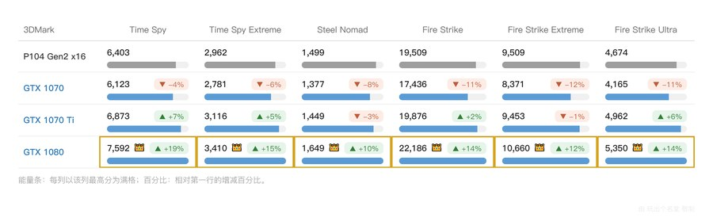
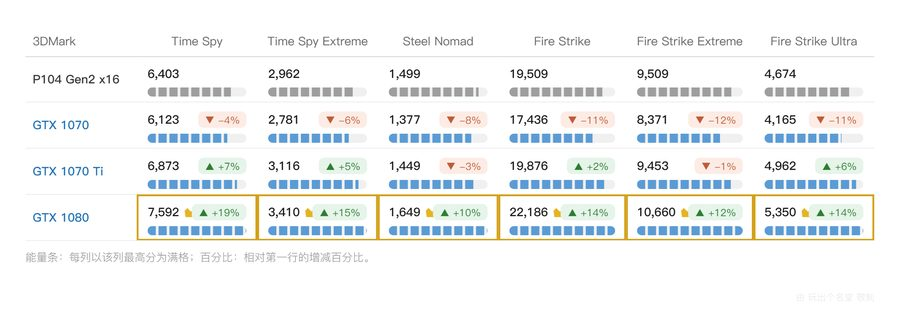
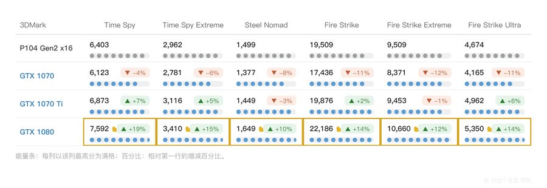
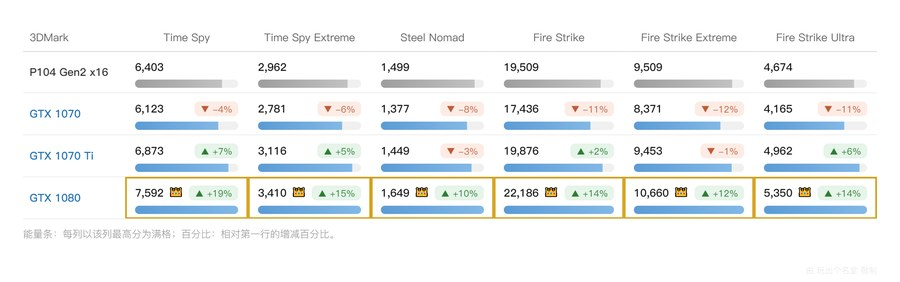
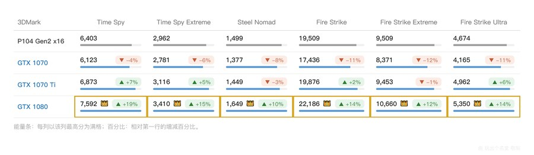
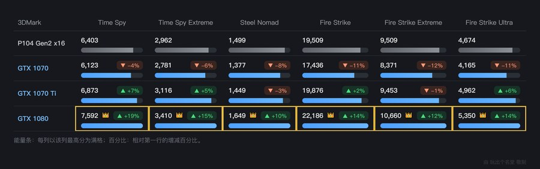
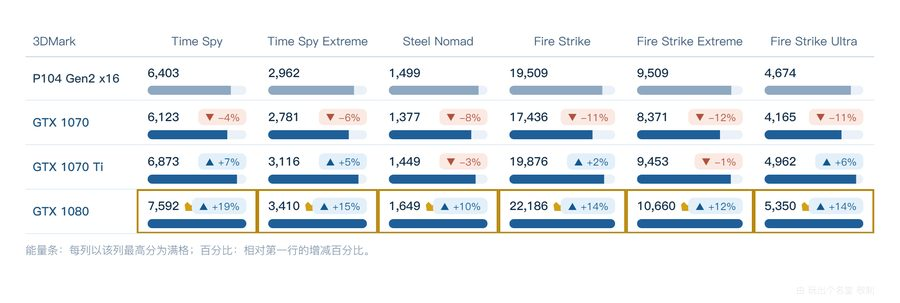
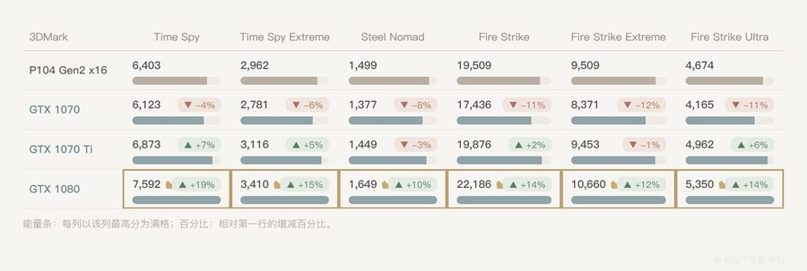

# 对比表生成器 · 全功能版

**中文** | [English](README_EN.md)

> 本工具由「玩出个名堂——更具温度的怀旧数码玩乐指南」制作

一个纯前端、零依赖、可离线使用的对比表生成器。填入数值，自动生成带能量条、第一名高亮、相对涨跌百分比的对比表格，并可导出高清 PNG 图片或独立 HTML 网页。

## 全端可用

**PC、手机、平板，有浏览器就能用。** 无需安装、无需联网、无需后端——双击 HTML 文件即可打开。响应式布局适配各种屏幕宽度，手机上也能横向滑动查看宽表格。

## 功能特性

- **📋 批量粘贴**：从 Excel / WPS / Numbers 复制整块数据，点任意单元格按 `Ctrl+V` 直接导入——自动识别标题、列名、行名，自动扩行扩列，不用逐个录入
- **双层表头**：Excel 里合并居中的分组表头（如「3DMark」下再分「总分 / 图形分」）粘贴后自动还原，预览、PNG、导出网页同步渲染
- **智能清洗**：千分位逗号、货币符号、百分号、全角数字、各种破折号负号都能正确识别
- **粘错可撤销**：粘贴后底部常驻「撤销」条，一键回到粘贴前，不会自动消失
- **可视化配置**：表格标题、左上角表头、底部说明文字均可自定义
- **列管理**：自由增删列，每列可设为「数值」或「百分比」类型
- **行管理**：自由增删行，第一行为参照行（其他行的涨跌百分比以其为基准）
- **第一名高亮**：小皇冠 + 金色描边，两项独立开关
- **5 种能量条样式**：经典实心 / 晶格分格 / 圆点胶囊 / 渐变流光 / 细线极简
- **4 套皮肤**：默认 / 深色模式 / 商务蓝 / 莫兰迪色系，界面与表格同步换肤
- **点击表头排序**：点一次降序，再点升序，第三次取消
- **📷 自适应宽度截图**：PNG 会按**当前页面宽度**出图——画面与能量条的长度随窗口宽窄按比例伸缩，宽屏出宽图、窄屏出窄图，条长与列宽始终协调，不会变形或溢出
- **多格式导出**：高清 PNG、复制 HTML 代码、下载独立网页
- **🧩 保存为我的模板**：把你自定义的列名、型号、标题和样式保存成一份空白模板，下次打开只填数值即可套用，无需每次重设

## 效果预览

以下样图均由工具自身导出，实际使用时以当前页面宽度出图，效果所见即所得。

### 5 种能量条样式

经典实心 · 晶格分格 · 圆点胶囊 · 渐变流光 · 细线极简：

| 经典实心 | 晶格分格 |
| :---: | :---: |
|  |  |

| 圆点胶囊 | 渐变流光 |
| :---: | :---: |
|  |  |

| 细线极简 | 
| :---: |
|  |

### 4 套皮肤（界面与表格同步换肤）

默认 · 深色模式 · 商务蓝 · 莫兰迪色系：

| 默认 | 深色模式 |
| :---: | :---: |
|  |  |

| 商务蓝 | 莫兰迪 |
| :---: | :---: |
|  |  |

## 使用方法

直接用浏览器打开 `对比表生成器.html` 即可，无需安装、无需联网。

1. 在「① 表格标题 / 说明文字」填写标题与说明
2. 在「② 列名」增删指标列并设置类型
3. 在「③ 行数据」填写型号与各列数值（第一行是参照行）
4. 选择高亮选项、能量条样式、皮肤
5. 在「⑥ 实时预览」查看效果，点击表头可排序
6. 在「⑦ 导出与分享」导出 PNG 图片或 HTML 网页

> 💡 **导出 PNG 前可先调整浏览器窗口宽度**：图片会按当前预览宽度生成，能量条长度和列宽同步按比例缩放。想出宽图就把窗口拉宽，想出紧凑图就收窄，所见即所得。

### 从 Excel 粘贴整表（V1.1 新增，最省事）

不用手填，直接把表格搬进来：

1. 在 Excel / WPS / Numbers 里选中整块区域（**可以连大标题、表头一起选**）复制
2. 回到工具，点「③ 行数据」里任意一个单元格，按 `Ctrl+V`
3. 工具会自动识别：大标题 → 页面标题，左上角 → 左上角表头，表头行 → 列名（双层表头自动还原为分组），首列文字 → 行名；列数与行数按内容自动扩增
4. 底部会出现常驻提示条，粘错了点「撤销」即可完整还原（连标题和角标一起回退）

> 少选几列也行：只粘贴数值块时会从当前单元格开始向右下填充，不影响已有的列名与行名。

### 复用模板（推荐）

配置好一套你常用的结构后，不必每次从头设置：

1. 按上面步骤配好列名、型号行、标题、皮肤和能量条样式（数值可随意填）
2. 在「⑦ 导出与分享」点击 **「🧩 保存为我的模板」**，会下载一份 `XXX_我的模板.html`
3. 下次打开这份模板，列名、型号、标题、样式都还在，**数值已清空**，直接填入新数值即可
4. 填完照常导出 PNG 或 HTML 网页

> 模板是完全独立的单文件，包含全部功能；你也可以把它当作日常使用的主文件。

## 百分比计算规则

- 每行的涨跌百分比 = `本行数值 ÷ 参照行（第一行）数值 − 1`，参照行自身不显示百分比
- 能量条以「该列最高分」为满格

## 更新日志

### V1.1（2026-11-18）

- **新增批量粘贴**：从 Excel / WPS / Numbers 复制整块数据，`Ctrl+V` 整表导入，自动识别标题 / 列名 / 行名，自动扩行扩列
- **新增合并单元格多层表头**：Excel 合并居中的双层表头粘贴后自动还原为分组表头，输入区、实时预览、PNG、导出网页四处一致
- **表头识别重写**：改为按「数字密度」判定，容忍左上角留空、某列没写列名、列名本身是数字（2024 / 1660）等常见写法
- **标题行不再挤占表头**：整表复制带上大标题时会自动摘出标题，「① 表格标题 / 说明文字」里的页面标题与左上角表头随之同步
- **数值清洗**：千分位、货币符号、百分号、全角数字、破折号负号均能正确解析
- **常驻撤销条**：粘贴后底部固定显示「撤销」，永不自动消失，一键完整回滚（含标题与角标）
- 若干细节修复：预览 / PNG / 导出网页此前缺少大标题的问题、导出列宽计算

### V1.0（初始发布）

- 完整的全功能版本：能量条、第一名高亮、涨跌百分比、5 种条样式、4 套皮肤、点击表头排序、自适应宽度 PNG、HTML 导出、保存自定义模板

## 版权声明

本工具由「玩出个名堂」原创开发并免费分享。生成的表格可自由使用；但未经授权，请勿将本生成器源码用于商业倒卖，或去除水印后二次发布。详见 [LICENSE](LICENSE)。

---

由 **玩出个名堂** 敬制

*更具温度的怀旧数码玩乐指南*

