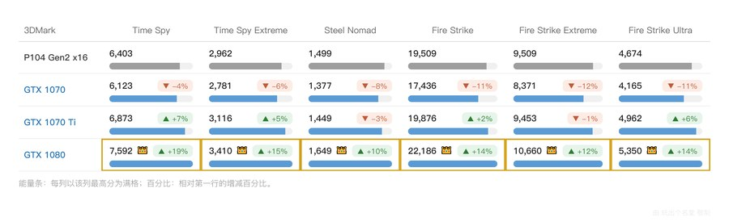
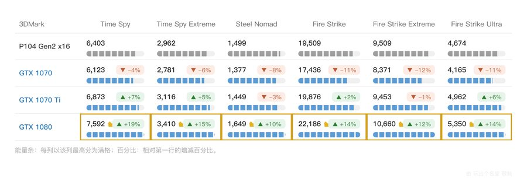
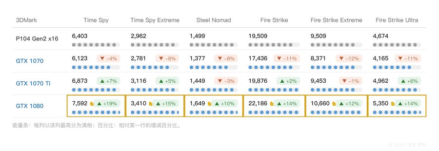
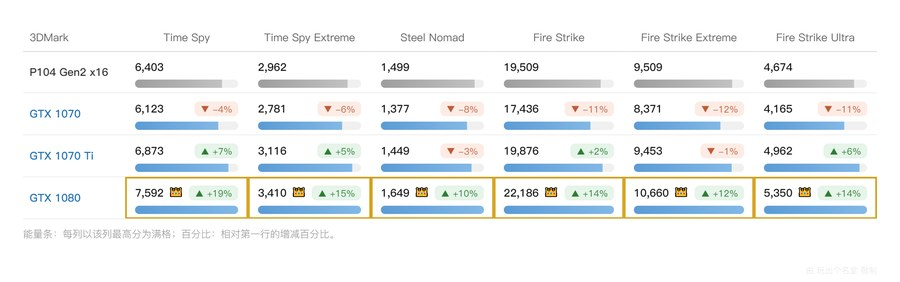
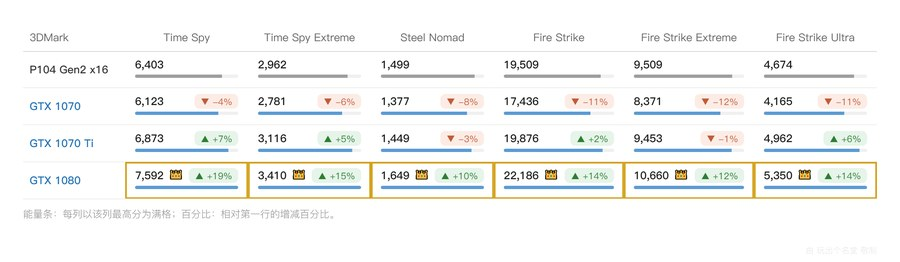
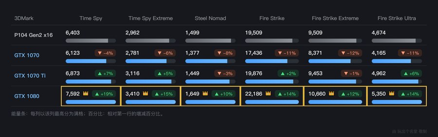
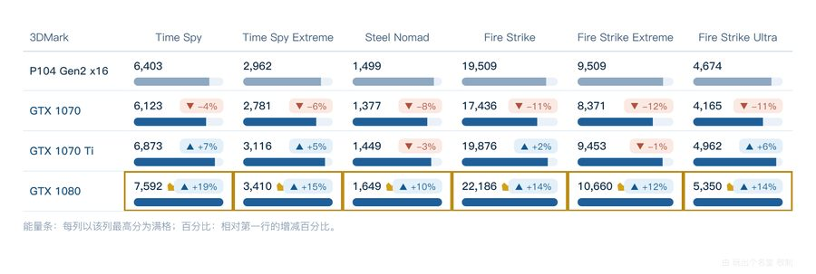
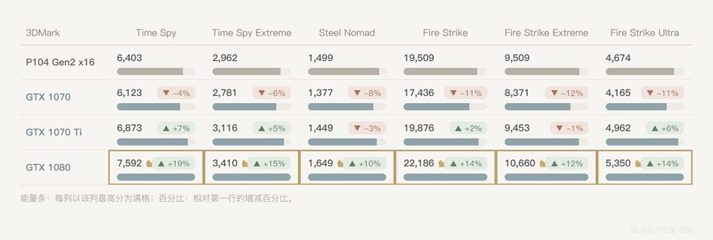

# Comparison Table Generator - Full Featured

[中文](README.md) | **English**

> Made by WanChuGeMingTang - the warmer guide to retro digital fun

A pure front-end, zero-dependency, offline-capable comparison table generator. Enter your numbers and it automatically builds a table with energy bars, winner highlighting, and relative change percentages. Export it as a high-resolution PNG or a standalone HTML page.

**⬇️ [Download the latest version (Releases)](https://github.com/WanChuGeMingTang/compare-table-generator/releases/latest)** · a single HTML file, just double-click it

## Works Everywhere

**PC, phone, or tablet - all you need is a browser.** No install, no internet, no backend. Just double-click the HTML file. The responsive layout adapts to any screen width, and wide tables can be scrolled horizontally on phones.

**📋 Paste table content directly**: copy straight from Excel, WPS, Numbers, Google Sheets, Tencent Docs, or any web table - bring the big title, a single header row, or a merged two-level header along with it. The tool automatically tells a "numbers-only fill" from a "whole-table import": a whole table restores titles / column names / row names and expands rows and columns, while plain numbers fill the focused cell. Paste by mistake? One-click undo.

## Features

- **📋 Bulk paste**: copy a whole block from Excel / WPS / Numbers and press `Ctrl+V` on any cell - titles, column names and row names are detected automatically, and rows/columns expand as needed. No manual typing
- **Two-level headers**: merged group headers from Excel (e.g. "3DMark" over "Total / Graphics") are restored automatically and render the same way in the preview, the PNG and the exported page
- **Smart cleanup**: thousands separators, currency symbols, percent signs, full-width digits and any kind of dash are all parsed correctly
- **Undo after pasting**: a persistent Undo bar at the bottom takes you back to the state before the paste; it never auto-dismisses
- **Visual configuration**: customize the table title, top-left header, and footer note
- **Column management**: freely add or remove columns; each can be a Number or Percentage column
- **Row management**: freely add or remove rows; the first row is the reference (all other rows' percentages are based on it)
- **Winner highlighting**: crown + gold outline, with two independent toggles
- **5 energy bar styles**: Classic Solid / Lattice / Dot Capsule / Gradient Glow / Thin Minimal
- **4 skins**: Default / Dark / Business Blue / Morandi - both the interface and the table change together
- **Sort by header**: click once for descending, again for ascending, a third time to clear
- **📷 Width-adaptive screenshots**: the PNG is drawn at the **current page width** - the frame and the bars scale proportionally with the window, so wide windows make wide images and narrow windows make compact ones, with bars and columns always in proportion and no distortion or overflow
- **Multiple export formats**: high-resolution PNG, copy HTML code, or download a standalone web page
- **🧩 Save as My Template**: save your custom column names, models, title, and styles as a blank template. Next time just fill in the numbers - no setup needed again

## Preview

All sample images below were exported by the tool itself. In real use the image is drawn at the current page width, so what you see is what you get.

### 5 Energy Bar Styles

Classic Solid - Lattice - Dot Capsule - Gradient Glow - Thin Minimal:

| Classic Solid | Lattice |
| :---: | :---: |
|  |  |

| Dot Capsule | Gradient Glow |
| :---: | :---: |
|  |  |

| Thin Minimal |
| :---: |
|  |

### 4 Skins (interface and table change together)

Default - Dark - Business Blue - Morandi:

| Default | Dark |
| :---: | :---: |
|  |  |

| Business Blue | Morandi |
| :---: | :---: |
|  |  |

## How to Use

Just open `Comparison Table Generator · EN.html` in a browser - no install, no internet required.

1. Fill in the title and note under "① Table Title / Description"
2. Add or remove metric columns under "② Columns" and set each type
3. Enter model names and values under "③ Rows" (the first row is the reference)
4. Choose the highlight options, energy bar style, and skin
5. Check the result under "⑥ Live Preview" - click a header to sort
6. Export a PNG or HTML page under "⑦ Export & Share"

> 💡 **Adjust the browser window width before exporting a PNG**: the image is generated at the current preview width, and the bar lengths and column widths scale together. Widen the window for a wide image, narrow it for a compact one - what you see is what you get.

### Paste a whole table from Excel (new in V1.1, fastest way)

No typing needed - move the table straight in:

1. Select the block you want in Excel / WPS / Numbers (**title and headers included**) and copy it
2. Back in the tool, click any cell under "③ Rows" and press `Ctrl+V`
3. The tool detects: a big title → Page Title, the top-left cell → Top-left Header, header rows → column names (two-level headers become groups), the text in the first column → row names; columns and rows grow to fit
4. A persistent bar appears at the bottom - if something went wrong, hit Undo to restore everything, title and corner label included

> Selecting only the numbers works too: the block is filled right and down from the focused cell without touching existing column or row names.

### Reusing a Template (recommended)

Once you have configured a structure you use often, you do not need to set it up from scratch every time:

1. Follow the steps above to set your columns, model rows, title, skin, and bar style (any values are fine)
2. Under "⑦ Export & Share" click "🧩 Save as My Template" - it downloads a file named `XXX_my-template.html`
3. Open that template next time: your columns, models, title, and styles are all there, **values are cleared**, so just fill in the new numbers
4. Export a PNG or HTML page as usual

> The template is a fully self-contained single file with all features; you can even use it as your everyday main file.

## Percentage Calculation Rules

- Each row's change percentage = `this row's value ÷ reference row (first row) value - 1`; the reference row itself shows no percentage
- The energy bar is scaled so the highest value in that column is full

## Changelog

### V1.1 (2026-11-18)

- **New: bulk paste** - copy straight from Excel / WPS / Numbers / Google Sheets / Tencent Docs / web tables and press `Ctrl+V`; big titles, single header rows and merged two-level headers can be copied along with the data. It automatically tells a "numbers-only fill" from a "whole-table import", detects titles / column names / row names, and expands rows and columns
- **New: merged two-level headers** - merged group headers copied from Excel become grouped columns, rendered consistently in the input area, live preview, PNG and exported page
- **Header detection rewritten** - based on numeric density, tolerating a blank top-left cell, a column without a name, and numeric column names (2024 / 1660)
- **Title rows no longer eat a header row** - a big title copied with the table is pulled out into the Page Title, and the Top-left Header follows the paste
- **Number cleanup** - thousands separators, currency symbols, percent signs, full-width digits and dashes are parsed correctly
- **Persistent undo bar** - stays at the bottom after a paste and restores everything in one click, title and corner label included
- Smaller fixes: the missing big title in preview / PNG / exported page, and column width measurement during export

### V1.0 (initial release)

- The complete full-featured version: energy bars, winner highlighting, change percentages, 5 bar styles, 4 skins, sort by header, width-adaptive PNG, HTML export, custom template saving

## Copyright

This tool was originally developed and shared for free by WanChuGeMingTang. Generated tables may be used freely; however, without authorization, please do not resell the generator source code or redistribute it after removing the credit line. See [LICENSE](LICENSE).

---

Made by **WanChuGeMingTang**

*the warmer guide to retro digital fun*

